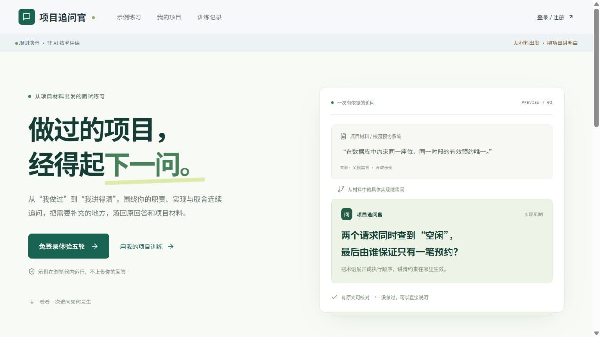
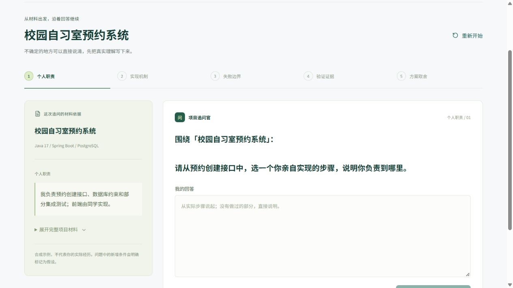

<div align="center">

# 项目追问官

**做过的项目，经得起下一问。**

围绕你的项目材料练习连续技术追问，<br />
把“我做过”，变成讲得清楚的实现、取舍与验证。

<p>
  
  
  
  
</p>

[快速开始](#快速开始) · [产品设计](docs/PRODUCT_DESIGN.md) · [参赛说明](docs/COMPETITION.md) · [反馈问题](https://github.com/znnnnnnn-wil/project-probe-studyhack/issues)

</div>



> **当前版本：本地参赛开发版。** 默认规则演示，无需模型密钥即可体验；真实模型调用与 Qoder Sites 公网部署尚待验收。

## 从材料出发，沿着回答继续

简历上写了“数据库约束”，被追问到两个请求同时到达时，能不能讲清楚它在哪里生效？

项目追问官面向准备后端与 Agent 开发实习的学生，围绕自己实际参与的项目练习。不会、没做过或尚未验证的地方，都可以直接说明。

| 整理项目 | 连续追问 | 证据复盘 |
| :--- | :--- | :--- |
| 从简历、README 和个人职责开始，明确自己做了什么 | 沿着职责、实现、失败、验证与取舍，完成五轮练习 | 回看原问题、原回答与材料依据，记录补充任务并导出 |

```text
项目材料  →  五轮追问  →  回看依据  →  补充笔记  →  导出复盘
```

<details>
<summary>查看五轮练习界面</summary>



</details>

## 两种方式，开始练习

### 先试一个熟悉的场景

免登录示例完全在浏览器内运行，不需要后端或模型额度。

| 合成项目 | 你会遇到的追问 |
| :--- | :--- |
| 校园自习室预约系统 | 两个请求同时查到座位空闲，最后由谁保证只成功一笔？ |
| 课程资料问答助手 | 召回片段与问题无关时，系统应该如何处理？ |
| 校园通知定时发送服务 | 通知已发送但接口返回超时，这条任务应不应该重试？ |

回答、草稿、自查状态和笔记保存在当前标签页；支持回看已提交问答、刷新恢复和 Markdown 导出。示例使用固定规则引导，不对技术正确性评分。

### 再换成自己的项目

注册账号后，填写项目名称与个人职责，按需补充架构、实现、README 或脱敏代码片段，即可免费完成一轮五题训练，无需购买训练包。

后端保存训练开始时的材料快照与原问答。配置真实模型后，复用模型服务生成追问和带引用的反馈；生成失败会保留进度并提示恢复。

## 快速开始

需要 **Node.js 22.12+**。自有项目训练还需要 **Java 17、Maven 3.9+**。

### 1. 获取代码

```bash
git clone https://github.com/znnnnnnn-wil/project-probe-studyhack.git
cd project-probe-studyhack
```

### 2. 启动前端，体验示例

```bash
cd frontend
npm ci
npm run dev
```

打开 **[http://localhost:5273/](http://localhost:5273/)**，点击「免登录体验五轮」。

### 3. 启动后端，使用自己的项目

在仓库根目录另开一个 PowerShell 终端：

```powershell
./scripts/start-backend.ps1
```

前端保持运行，刷新页面后即可注册并保存自己的项目。后端默认监听 `127.0.0.1:8180`，本地数据保存在 `backend/data`。

<details>
<summary>手动启动与模型配置</summary>

也可以在 `backend` 目录执行 `mvn spring-boot:run`。Windows 使用 `mvn.cmd`；前端 Windows 启动脚本为 `./scripts/start-frontend.ps1`。

要使用真实 AI，将根目录的 `.env.example` 复制为 `.env`，填写自己的模型地址、名称和密钥，再通过后端启动脚本运行。直接用 Maven 启动时，需自行向进程提供环境变量。

密钥仅由后端读取，不应放入前端或提交到仓库。当前副本没有复用原部署的凭证或调用额度。

</details>

## 技术与验证

| 层级 | 实现 |
| :--- | :--- |
| 前端 | React 19 · TypeScript · Vite · Hash 路由 |
| 示例体验 | 浏览器规则引擎 · sessionStorage |
| 后端 | Java 17 · Spring Boot · Flyway |
| 数据存储 | 本地默认 H2，保留 PostgreSQL 配置能力 |
| 模型接入 | 服务端 OpenAI 兼容接口适配 |

<details>
<summary>构建与浏览器验收命令</summary>

后端，在 `backend` 目录：

```bash
mvn package
```

前端，在 `frontend` 目录：

```bash
npm run build
npm exec playwright test -- --config playwright.competition.config.ts
```

浏览器验收默认使用独立的 `5175 / 18083` 端口、H2 内存数据库、合成账号和规则模型。若已启动本副本，也可在 PowerShell 中针对本地服务执行：

```powershell
$env:PROBE_TEST_EXTERNAL_URL='http://localhost:5273'
npm exec playwright test -- --config playwright.competition.config.ts
```

上述验收不调用真实模型或发起付款。前端静态产物位于 `frontend/dist`；自有项目功能还需要后端及同源 `/api` 代理。

</details>

## 文档与协作

| 文档 | 内容 |
| :--- | :--- |
| [产品设计](docs/PRODUCT_DESIGN.md) | 用户场景、核心流程、数据依据与验收标准 |
| [参赛准备](docs/COMPETITION.md) | 三分钟演示脚本、发布边界与提交前准备 |
| [移植记录](docs/MIGRATION.md) | 原项目来源、本次改动与验证范围 |

每个 PR 关联一个 Issue，新增与删除行数合计不超过 **500 行**；GitHub Actions 检查行数与 `Closes #编号`。

本项目基于已有 ProjectProbe 改造。当前尚未提交比赛；本次改造使用 Codex，比赛要求的 Qoder 开发、调试和部署记录需实际完成后补充，详见参赛说明。

---

<div align="center">

**每一次追问，都离讲明白更近一步。**

<sub>练习反馈仅供参考，不承诺面试或录用结果。项目材料、回答与自查不等于技术已经独立验证。</sub>

</div>
